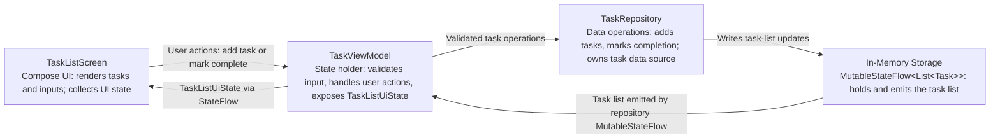

# Employee Task Manager - Architecture Documentation

**Document Version:** 1.1 (Diagram Aligned)  
**Phase:** Day 3 Architecture & Design Documentation  
**Project:** `EmployeeTaskManager-Kotlin`  

---

## 1. Architecture Overview

The Employee Task Manager application follows a beginner-friendly MVVM (Model-View-ViewModel) architectural pattern designed with clean separation of concerns, testability, and modern Jetpack Compose standards.

### Architecture Diagram

Mermaid source: [`docs/diagrams/architecture.mmd`](diagrams/architecture.mmd).



---

## 2. MVVM Architecture

The application separates concerns across three core MVVM components:

### Model
- Represents core task information (`Task.kt`).
- Includes a unique task ID (`id: String = UUID.randomUUID().toString()`), required title (`title: String`), optional description (`description: String = ""`), and completion status (`isCompleted: Boolean = false`).

### View
- Implemented using Jetpack Compose and Material 3 principles (`TaskListScreen.kt`).
- Displays the scrollable task list, input fields, status indicators, empty state message, and inline validation error feedback.
- Captures user interactions (entering text, tapping "Add Task", marking complete, and triggering Day 2 Toast actions) and delegates events to the ViewModel.

### ViewModel
- Extends `androidx.lifecycle.ViewModel` (`TaskViewModel.kt`).
- Manages and exposes UI state using `StateFlow<TaskListUiState>`.
- Handles task-related actions (adding tasks, marking tasks complete).
- Performs blank-title validation (ensuring titles are non-empty and not whitespace-only after `.trim()`).
- Exposes validation error messages through `TaskListUiState` (`errorMessage: String?`).
- Communicates directly with `TaskRepository`.

---

## 3. Repository Layer

The repository layer (`TaskRepository.kt`) acts as the single source of truth for task data operations.

### Responsibilities
- Managing in-memory task data using a `MutableStateFlow<List<Task>>`.
- Providing data operations: `getTasks()`, `addTask(title, description)`, and `markTaskComplete(taskId)`.
- Using `MutableStateFlow` to expose reactive updates to the ViewModel.
- Explicitly allowing duplicate task titles while assigning unique task IDs (`UUID`) to ensure distinct identity and prevent state management key collisions.
- **Singleton Rule:** No Singleton pattern is introduced for `TaskRepository` because ViewModel scoping provides sufficient lifecycle retention for in-memory data during configuration changes.

---

## 4. Data Flow

### Task Addition Flow
1. User enters a required task title and optional task description in the input fields.
2. User taps the **"Add Task"** button.
3. The UI delegates the action event to `TaskViewModel`.
4. `TaskViewModel` validates the title input (checking for blank or whitespace-only strings using `.trim()`).
5. **Invalid Input:** Produces inline validation error feedback (`errorMessage = "Task title cannot be empty"`) and blocks task creation.
6. **Valid Input:** Passes the sanitized title and description to `TaskRepository`.
7. `TaskRepository` creates a new `Task` object with a unique UUID and updates the in-memory task list.
8. The updated task list flows through `MutableStateFlow` to `TaskViewModel` and is exposed via `StateFlow` in `TaskListUiState`.
9. The UI observes the new state and renders the updated task list along with an empty input state and cleared error message.

### Task Completion Flow
1. User taps the **"Complete"** action button on a pending task item.
2. The UI delegates the completion event with the `taskId` to `TaskViewModel`.
3. `TaskViewModel` calls `TaskRepository.markTaskComplete(taskId)`.
4. `TaskRepository` locates the task by its unique ID, sets `isCompleted = true` (one-way), and emits the updated task list.
5. The UI observes the state change and updates the task's visual status badge to "Completed".

---

## 5. Task Completion Rules

Task completion is governed by strict business rules:
- **One-Way Progression:** Task completion is strictly **one-way**: Pending $\rightarrow$ Completed (`isCompleted = true`).
- **No Reversion:** Completed tasks cannot be toggled back to Pending.
- **Idempotency:** Repeated completion requests on an already completed task are handled idempotently. A completed task remains successfully completed when the action is triggered again, without corrupting state or triggering errors.

---

## 6. UI Components (`TaskListScreen.kt`)

The planned `TaskListScreen` interface includes:
- **Required Task Title Input Field:** An `OutlinedTextField` capturing the task title with multi-line text wrapping support.
- **Optional Task Description Input Field:** An `OutlinedTextField` configured for multi-line input.
- **Add Task Button:** Triggers validation and task insertion.
- **Inline Validation Message:** Displays `"Task title cannot be empty"` when submission fails validation.
- **Scrollable Task List:** A `LazyColumn` displaying task cards.
- **Task Status Indicators:** Material 3 color badges distinguishing Pending versus Completed tasks.
- **Task Completion Action:** Button/action to mark tasks as completed.
- **Empty Task List Message:** Placeholder text (*"No tasks available. Add a new task to get started!"*) when zero tasks exist.
- **Text Wrapping:** Full multi-line support for long titles and descriptions within cards.
- **Day 2 Toast Action:** An accessible button or header triggering the existing Day 2 Toast handler (`showTaskDetailToast(context)`).

---

## 7. State Management and Lifecycle

- **`TaskListUiState`:** A data class representing the immutable UI state snapshot exposed by the ViewModel (`tasks`, `titleInput`, `descriptionInput`, `errorMessage`).
- **`StateFlow`:** Used to stream reactive UI state updates efficiently from the ViewModel to Compose.
- **Configuration Change Retention:** ViewModels survive configuration changes (such as device rotation). Consequently, `TaskRepository` scoped within the ViewModel retains in-memory task data across rotations without requiring Singleton complexity or external database injection.
- **Process Destruction Limitation:** Because storage is strictly in-memory, **process destruction** by the OS (reclaiming memory while backgrounded) results in task data loss. 
- **Future Persistence:** Room database integration is designated as a future architectural enhancement.

---

## 8. Proposed Package Structure & Integration

```text
app/src/main/java/com/example/employeetaskmanager/
│
├── data/
│   ├── model/
│   │   └── Task.kt                  <-- Task data class & status enum
│   └── repository/
│       └── TaskRepository.kt        <-- In-memory data source & operations
│
└── ui/
    ├── viewmodel/
    │   └── TaskViewModel.kt         <-- State management & UI events
    └── screens/
        └── TaskListScreen.kt        <-- Jetpack Compose UI screen
```

### `MainActivity.kt` Integration
`MainActivity.kt` will undergo a targeted update to its `setContent` block to render `TaskListScreen` within `EmployeeTaskManagerTheme`. All existing Day 1 lifecycle overrides (`onCreate`, `onStart`, `onResume`, `onPause`, `onStop`), Logcat debugging logs under tag `"EmployeeApp"`, and Day 2 Toast handlers (`onTaskDetailButtonClicked`, `showTaskDetailToast`) will be strictly preserved and remain fully operational.

---

## 9. Testing Considerations

The planned testing strategy includes:
1. **Task Creation Tests:** Verifying default field initialization and unique UUID generation.
2. **Valid Task Addition Tests:** Confirming successful addition and input resetting.
3. **Optional Description Tests:** Ensuring tasks with and without descriptions are handled correctly.
4. **Blank-Title Validation Tests:** Verifying that blank or whitespace-only inputs trigger inline error messages (`"Task title cannot be empty"`) and block creation.
5. **Duplicate Title & Unique ID Tests:** Confirming duplicate titles are permitted while maintaining distinct IDs.
6. **One-Way & Idempotent Completion Tests:** Verifying Pending $\rightarrow$ Completed progression and idempotent re-clicks.
7. **Rotation & ViewModel State Retention Tests:** Verifying task list persistence across screen rotation.
8. **Process Destruction Limitation:** Acknowledging in-memory data loss on process death.
9. **Day 1 Lifecycle Logcat Regression Tests:** Verifying `"EmployeeApp"` Logcat outputs during activity transitions.
10. **Day 2 Toast Regression Tests:** Verifying `showTaskDetailToast` execution when triggered from the UI.

---

## 10. Architecture Decisions and Constraints

### Justification
MVVM and the Repository layer are chosen to establish professional separation of concerns, robust testability, and clean state management, while remaining lightweight and beginner-friendly.

### Constraints
- Reuse existing Android and Jetpack Compose dependencies (Compose BOM `2026.02.01`).
- Do not add unnecessary external libraries.
- Do not introduce complex dependency injection frameworks.
- Do not implement database persistence in this phase.
- Preserve existing Day 1 and Day 2 functionality.

---

## 11. Documentation Status

- **Architecture Documentation Status:** COMPLETED
- **Coding Status:** NOT STARTED
- **Trainer Approval:** PENDING
