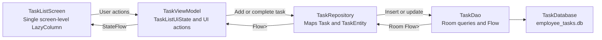

# Employee Task Manager — As-Built Architecture

**Document version:** 2.0
**Updated:** 2026-11-18
**Scope:** Current Day 4 implementation

This document describes the architecture present in the application source. The Day 3 planning documents describe the earlier in-memory proposal; the current application implementation uses Room.

## Architecture overview

The app follows a single-Activity Compose UI with a ViewModel, repository, DAO, and Room database:

## Components

### Activity and dependency setup

`MainActivity` obtains the application-scoped `TaskDatabase` singleton, creates a `TaskRepository` from its `TaskDao`, and supplies the repository through `TaskViewModelFactory` to an Activity-scoped `TaskViewModel`. It hosts `TaskListScreen` inside the app theme and `Scaffold`.

The Activity lifecycle log calls and Day 2 Toast handlers remain in `MainActivity.kt`.

### UI — `TaskListScreen.kt`

The screen collects `TaskViewModel.uiState`. A single screen-level `LazyColumn` owns vertical scrolling:

- Its header item contains the Toast action, Add New Task form, summary cards, Task List heading, and empty-state message.
- Task cards are keyed lazy items in that same list.
- There is no nested `LazyColumn`; the form, summary, and task cards can all be reached by scrolling in landscape and portrait.
- Each card displays a Pending or Completed badge. The completion action is shown only for pending tasks.

### ViewModel — `TaskViewModel.kt`

The ViewModel exposes `StateFlow<TaskListUiState>` to Compose and collects the repository task flow. It validates blank or whitespace-only titles, maintains form input and error state, delegates add and completion actions, and computes summary counts.

### Repository — `TaskRepository.kt`

The repository observes `TaskDao.observeTasks()` and maps `TaskEntity` values to the `Task` model. Adding a task trims title and description, creates a UUID, and stores it with pending status. Completion is delegated to the DAO.

### Local data — `TaskDatabase`, `TaskDao`, and `TaskEntity`

- `TaskDatabase` is a Room database with a singleton instance and database name `employee_tasks.db`.
- `TaskEntity` maps to the `tasks` table and uses the task ID as its primary key.
- `TaskDao.observeTasks()` returns a Room `Flow<List<TaskEntity>>`.
- `insertTask` uses `OnConflictStrategy.REPLACE`.
- Completion uses `UPDATE tasks SET isCompleted = 1 WHERE id = :taskId AND isCompleted = 0`.

The task model supplies UUID IDs and defaults new tasks to incomplete.

## Data flows

### Add task

1. Compose input changes update the ViewModel state.
2. The ViewModel rejects an empty or whitespace-only title with the inline validation message.
3. For valid input, the ViewModel calls the repository.
4. The repository trims title and description, creates a pending task with a unique ID, and inserts its entity through the DAO.
5. Room emits the updated task list; the repository maps it to models, the ViewModel updates UI state, and Compose renders the new task and summary counts.

### Complete task

1. The card action sends the task ID to the ViewModel.
2. The repository calls the DAO's one-way update query.
3. Room emits the updated record and the UI displays the Completed badge.
4. The action is hidden for completed tasks. The DAO update condition makes repeat completion requests leave the completed state unchanged.

## Persistence and lifecycle

Room stores task records in the app database, so task data is designed to survive Activity recreation and process restart. The current instrumented test verifies that records and completion status survive closing and reopening a Room database. That test uses a unique temporary database name; end-to-end app behavior after process restart has **not** been tested.

The Activity-scoped ViewModel also retains form/UI state across configuration changes, but unsubmitted input retention has not been manually verified.

## Verification recorded

- **Build:** `app:assembleDebug` succeeded after the landscape scrolling change.
- **Unit tests:** Forced `app:testDebugUnitTest --rerun-tasks` completed successfully; 13 tests passed.
- **Instrumented test:** `app:connectedDebugAndroidTest` completed successfully on the connected emulator. Its single test checks Room task and completion persistence after database reopen.
- **Emulator scrolling:** After deploying the updated build, a landscape swipe exposed the summary and task cards; further scrolling advanced through cards. The updated portrait hierarchy also exposed a scrollable screen.
- Empty-state UI, long-title wrapping, and end-to-end app process restart remain unverified.

## Day 3 planning traceability

The Day 3 plan records an in-memory repository as the proposed initial design. This file documents the Room-backed implementation that is currently in source; it does not claim that the Day 3 in-memory proposal was implemented. Treat the Day 3 plan as planning history and this document as the as-built architecture.
