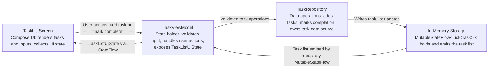

# Employee Task Manager - Day 3 Development Plan

**Document Version:** 1.3 (Audit Revised)  
**Phase:** Day 3 Planning & Architecture Review  
**Project:** `EmployeeTaskManager-Kotlin`  

---

## 1. Project Objective & Core Baseline

The objective of Day 3 development for **Employee Task Manager** is to introduce a clean, scalable, yet beginner-friendly MVVM (Model-View-ViewModel) architecture enabling employees to interact with tasks.

> **Core Requirement Baseline:**  
> *"Employees must view tasks, add tasks, mark complete, and see status."*

---

## 2. Current Project Architecture

The application currently operates on a single-Activity Jetpack Compose baseline:

- **Root Activity (`MainActivity.kt`):** Extends `ComponentActivity`, handles Android Activity lifecycle overrides (`onCreate`, `onStart`, `onResume`, `onPause`, `onStop`), and outputs Logcat debug logs under tag `"EmployeeApp"`.
- **UI Container:** Hosts Jetpack Compose content via `setContent { EmployeeTaskManagerTheme { Scaffold { ... } } }`.
- **Initial Composable UI:** Renders a baseline `@Composable Greeting` function with greeting text and a **"Task Detail Button Click"** button.
- **Event Flow:** Function-based callback chain inside `MainActivity.kt`:  
  `Button.onClick` $\rightarrow$ `onTaskDetailButtonClicked(context)` $\rightarrow$ `showTaskDetailToast(context)` $\rightarrow$ `Toast.makeText()`.

---

## 3. Proposed Architecture & Architectural Justification

To fulfill requirements while maintaining separation of concerns, the proposed Day 3 architecture introduces modern Android MVVM layers:



### Architectural Justification & Beginner-Friendliness
- **Why MVVM & Repository?** Separating the UI (`TaskListScreen`), state management (`TaskViewModel`), and data operations (`TaskRepository`) establishes clean boundaries, modular testability, and prepares the codebase for future database persistence (such as Room) without requiring UI rewrites.
- **Beginner-Friendly Design:** The implementation avoids complex dependency injection frameworks (like Hilt) for Day 3, keeping instantiation straightforward.
- **No Unnecessary Dependencies:** The architecture relies entirely on existing Jetpack Compose BOM (`2026.02.01`) and lifecycle dependencies already present in the project. No new Gradle dependencies or modifications are introduced.

### Component Responsibilities

#### 1. SCREEN – `TaskListScreen.kt`
- Renders the primary user interface using Jetpack Compose and Material 3 components.
- Displays the scrollable list of tasks (`LazyColumn`) with status badges.
- Displays an empty state message (*"No tasks available. Add a new task to get started!"*) when zero tasks exist.
- Provides a required Task Title input field, an optional multi-line Task Description input field, inline validation error feedback, and an "Add Task" button.
- Includes an accessible action button or header to trigger the Day 2 Task Detail Toast (`showTaskDetailToast(context)`).
- Captures employee interactions and delegates actions to `TaskViewModel`.

#### 2. VIEWMODEL – `TaskViewModel.kt`
- Extends `androidx.lifecycle.ViewModel`.
- Holds and exposes the UI state (`StateFlow<TaskListUiState>`) containing task items and validation error state (`errorMessage: String?`).
- Instantiates and retains `TaskRepository` within its lifecycle scope. Because ViewModels survive configuration changes (such as screen rotation), in-memory task data is retained across rotations without requiring Singleton complexity.
- Validates task input (ensuring task title is non-empty after `trim()`).
- Translates UI actions into repository operations (adding task, marking task complete).

#### 3. REPOSITORY – `TaskRepository.kt`
- Manages in-memory task data operations using a `MutableStateFlow<List<Task>>`.
- Provides methods: `getTasks()`, `addTask(title, description)`, `markTaskComplete(taskId)`.
- No Singleton pattern is introduced since ViewModel retention provides sufficient lifecycle scoping for in-memory data during configuration changes.

#### 4. STORAGE – Local In-Memory Storage & Data Loss Notice
- Uses an in-memory `MutableStateFlow<List<Task>>` and assigns a unique identifier (`id: String = UUID.randomUUID().toString()`) to every created task to guarantee unique keys and robust duplicate-title handling.
- **Data Loss Warning:** Because storage is purely in-memory, **process destruction** (e.g., the OS reclaiming system memory while the app is in the background) will result in task data loss. Persistent storage (Room database) is designated as a future enhancement.

---

## 4. Proposed File Structure & `MainActivity.kt` Integration Plan

### Existing Files & Integration Plan

| File Path | Status | Responsibility / Modification Plan |
| :--- | :--- | :--- |
| `app/src/main/java/.../MainActivity.kt` | **Targeted Update** | Hosts Activity lifecycle overrides (`onCreate`, `onStart`, `onResume`, `onPause`, `onStop`), Logcat debugging logs under tag `"EmployeeApp"`, and Day 2 Toast handlers (`onTaskDetailButtonClicked`, `showTaskDetailToast`). During future implementation, its `setContent` block will undergo a targeted update to render `TaskListScreen` inside `EmployeeTaskManagerTheme`, while strictly preserving all existing lifecycle callbacks, Logcat messages, and the Day 2 Toast functionality (accessible via an action trigger in the task list UI). |
| `app/src/main/java/.../ui/theme/Color.kt` | **Reused Unchanged** | Defines Material 3 color palette. |
| `app/src/main/java/.../ui/theme/Theme.kt` | **Reused Unchanged** | Defines `EmployeeTaskManagerTheme` wrapper. |
| `app/src/main/java/.../ui/theme/Type.kt` | **Reused Unchanged** | Defines typography styles. |
| `AndroidManifest.xml` | **Preserved Unchanged** | App manifest and `.MainActivity` launcher declaration. |
| `app/build.gradle.kts` | **Preserved Unchanged** | App build configuration and dependencies. |

### Proposed New Files

```text
app/src/main/java/com/example/employeetaskmanager/
│
├── data/
│   ├── model/
│   │   └── Task.kt                  <-- Task data class & status enum
│   └── repository/
│       └── TaskRepository.kt        <-- In-memory data source & operations
│
└── ui/
    ├── viewmodel/
    │   └── TaskViewModel.kt         <-- State management & UI events
    └── screens/
        └── TaskListScreen.kt        <-- Jetpack Compose UI screen
```

### Responsibilities of Proposed New Files

1. **`data/model/Task.kt`**
   - Data class `Task(val id: String = UUID.randomUUID().toString(), val title: String, val description: String = "", val isCompleted: Boolean = false)`.

2. **`data/repository/TaskRepository.kt`**
   - Class defining in-memory operations: `getTasks()`, `addTask(title, description)`, `markTaskComplete(taskId)`.

3. **`ui/viewmodel/TaskViewModel.kt`**
   - Exposes `uiState: StateFlow<TaskListUiState>`.
   - Manages input states, validation logic, error messaging (`errorMessage: String?`), and task operations.

4. **`ui/screens/TaskListScreen.kt`**
   - Composable UI rendering `Card` layout for task items, required Title input field, optional multi-line Description input field, inline validation error text, "Add Task" button, status badges, empty state, and Day 2 Toast action trigger.

---

## 5. Core Feature Specifications

### 1. Task Completion (One-Way & Idempotent)
- **Behavior:** Task completion is strictly **one-way** (Pending $\rightarrow$ Completed). 
- Once an employee marks a task as complete (`isCompleted = true`), it cannot be toggled back to Pending.
- Re-clicking complete on an already completed task is handled **idempotently** (it remains completed without errors or state corruption).

### 2. Validation & Add Task Button Behavior
- **Validation Rule:** Task titles must be non-empty and contain non-whitespace characters after `.trim()`.
- **Inline Feedback:** If an employee attempts to add a task with a blank or whitespace-only title, the UI state updates `errorMessage` to `"Task title cannot be empty"`, the `OutlinedTextField` enters an `isError` state displaying inline error text, and task addition is blocked.
- **Button Behavior:** The "Add Task" button remains active; clicking it triggers validation. Upon successful addition, input fields are cleared and `errorMessage` is reset to `null`.

### 3. UI Input & Text Wrapping
- **Task Title:** Required `OutlinedTextField` supporting standard single-line input with automatic text wrapping for long titles.
- **Task Description:** Optional `OutlinedTextField` configured for multi-line text input.
- **Card Layout:** Task cards wrap long titles and descriptions cleanly across multiple lines without clipping or breaking layout boundaries.

---

## 6. Implementation Steps (Planned Sequence)

When implementation commences in future steps, coding will proceed in the following order:

1. **Step A: Task Data Model (`Task.kt`)**
   - Define data model attributes (`id`, `title`, `description`, `isCompleted`).

2. **Step B: Task Repository (`TaskRepository.kt`)**
   - Implement in-memory state repository with methods for fetching, adding, and one-way completing tasks.

3. **Step C: Task ViewModel & UI State (`TaskViewModel.kt`)**
   - Define `TaskListUiState` data class including `tasks: List<Task>`, `titleInput`, `descriptionInput`, and `errorMessage: String?`.
   - Implement ViewModel state handling, input sanitization (`.trim()`), blank-title validation, and one-way completion logic.

4. **Step D: Task List Screen Composable (`TaskListScreen.kt`)**
   - Construct Material 3 layout with input section (Title + Description + inline error), task cards with multi-line wrapping and status badges, completion action buttons, empty state display, and Day 2 Toast button.

5. **Step E: Integration with `MainActivity.kt`**
   - Update `MainActivity`'s `setContent` to render `TaskListScreen` within `EmployeeTaskManagerTheme`, ensuring all Day 1 lifecycle callbacks, Logcat messages under tag `"EmployeeApp"`, and Day 2 Toast handlers remain fully operational.

### Implementation Dependencies
- **A → B:** The repository depends on the `Task` model and its unique ID and default status.
- **B → C:** The ViewModel depends on repository operations and its task-list `StateFlow`.
- **C → D:** The screen depends on the ViewModel's `TaskListUiState` and event interface.
- **D → E:** Activity integration depends on the screen's composable API and its state/event wiring.
- Model and repository unit tests can be written alongside Steps A and B; ViewModel tests follow Step C. UI/integration and Day 1/Day 2 regression checks follow Step E.

### Codex Review Findings and Plan Revisions
- **Completion semantics:** Requirements now specify one-way, idempotent Pending → Completed behavior; no toggle back to Pending.
- **Title length:** No maximum is defined for this phase. Blank/whitespace titles are rejected; long titles wrap, removing the previous undefined “acceptable length limits” requirement.
- **Data ownership and lifecycle:** The ViewModel creates and retains the repository across configuration changes. The repository owns the in-memory `MutableStateFlow<List<Task>>`; process death can lose this data.
- **Rapid updates and input retention:** State updates are planned through StateFlow, and input fields are part of `TaskListUiState`; tests are listed for rapid additions and configuration changes.
- **Preservation and dependencies:** Activity integration remains last and explicitly preserves Day 1/Day 2 functionality and existing dependencies.

## 7. Testing Strategy

### Unit & Integration Testing Plan

1. **Task Model Tests:**
   - Verify `Task` creation with default `id` (UUID), default `isCompleted = false`, and parameter assignments.

2. **Repository Tests:**
   - Test adding a task updates `StateFlow`.
   - Test marking task complete sets `isCompleted = true` and verifies completion is one-way/idempotent (re-invocation preserves completed state).
   - Test duplicate titles receive unique IDs (`UUID`).

3. **ViewModel & Validation Tests:**
   - **Empty List Test:** Initial state produces empty task list and empty state flag.
   - **Valid Task Addition Test:** Submitting valid title and optional description adds task and resets input fields.
   - **Blank-Title Validation Test:** Submitting blank or whitespace-only title populates `errorMessage` (`"Task title cannot be empty"`) and blocks task addition.
   - **Duplicate Title Test:** Submitting identical titles creates two distinct items with unique IDs.
   - **Idempotent Completion Test:** Marking complete updates status one-way and re-clicking preserves completed state.

4. **Configuration Change & State Retention Tests:**
   - Verify screen rotation retains the in-memory task list and input states via ViewModel scoping.

5. **Day 1 & Day 2 Regression Testing:**
   - Verify `MainActivity` lifecycle events (`onCreate`, `onStart`, `onResume`, `onPause`, `onStop`) continue to output Logcat debug logs under tag `"EmployeeApp"`.
   - Verify Day 2 Toast handlers (`onTaskDetailButtonClicked`, `showTaskDetailToast`) execute correctly when triggered from the UI action button.

---

## 8. Edge Case Handling (Referenced from `docs/REQUIREMENTS.md`)

| Edge Case Scenario | Planned Handling Strategy |
| :--- | :--- |
| **1. Empty Task List** | Display explicit placeholder text (*"No tasks available. Add a new task to get started!"*). |
| **2. Empty Task Title** | Block submission; populate `errorMessage` and display inline validation error (`"Task title cannot be empty"`). |
| **3. Duplicate Task Title** | Allow duplicate titles; assign unique UUID to every task instance. |
| **4. Very Long Task Title** | Enable multi-line text wrapping on Compose text components. |
| **5. Rapid Multiple Additions** | Process state updates via `StateFlow` sequentially to prevent race conditions. |
| **6. Idempotent Completion** | Re-clicking complete on an already completed task preserves completed state cleanly (one-way, Pending $\rightarrow$ Completed). |
| **7. Status Visibility** | Use distinct Material 3 color badges (Primary for Pending, Secondary/Outline for Completed). |
| **8. Invalid Whitespace Input** | Apply `.trim()` sanitization on title and description inputs. |
| **9. Process Destruction & Data Loss** | Document in-memory limitation: process destruction by the OS results in data loss; configuration changes (rotation) are preserved via ViewModel. |
| **10. Unexpected User Actions** | Handle configuration changes via ViewModel without losing uncommitted input or crashing. |

---

## 9. Risks and Mitigation

| Risk | Impact | Mitigation Strategy |
| :--- | :--- | :--- |
| **Overwriting `MainActivity.kt` Logcat Logs** | High | Retain all existing lifecycle overrides (`onStart`, `onResume`, etc.) and `Log.d("EmployeeApp", ...)` logs. |
| **Disrupting Day 2 Toast Handlers** | High | Keep `onTaskDetailButtonClicked` and `showTaskDetailToast` intact in `MainActivity.kt` and provide an accessible UI trigger in `TaskListScreen`. |
| **State Loss on Screen Rotation** | Medium | Use `androidx.lifecycle.ViewModel` to hold state and repository data across configuration changes. |
| **Dependency Compatibility** | Medium | Work within existing Compose BOM `2026.02.01` and installed libraries without modifying Gradle files. |
| **UI Layout Overcrowding** | Low | Integrate `TaskListScreen` within `Scaffold` container with proper padding and scrollable lists (`LazyColumn`). |

---

## 10. Assumptions and Constraints

### Constraints
1. **Source Code Protection:** Day 1 and Day 2 code structure in `MainActivity.kt` (lifecycle methods, Toast handlers, Logcat logging) must remain preserved and functional.
2. **Build File Protection:** No edits to `app/build.gradle.kts`, `gradle/libs.versions.toml`, or `AndroidManifest.xml`.
3. **Planning Phase Constraint:** No Kotlin code implementation during this planning step.

### Assumptions
- Task data is stored in-memory during Day 3 execution.
- Jetpack Compose Material 3 components already present in project dependencies are sufficient for UI layout.

---

## 11. Review and Approval Status

| Status Category | Status |
| :--- | :--- |
| **Planning Status** | **REVISED & FINALIZED** |
| **Coding Status** | **NOT STARTED** |
| **Codex Review** | **PASSED** |
| **Trainer Approval** | **PENDING** |

---

## Verification & File Location Confirmation

- **Exact File Path:** `docs/DEVELOPMENT_PLAN.md`
- **Application Source Files Modified:** **0 application source files modified.**
